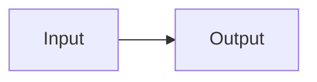

# Lesson Markdown Format (`build.py` Schema)

Every lesson (`lessons/NNNN-<slug>.md`) is compiled to `lessons/NNNN-<slug>.html` by `build.py`. Follow this exact syntax—`build.py` parses attributes with whitespace separation, **never** `{}` braces.

## Frontmatter & Header Links

```yaml
---
title: "Display Title Shown in H1 & Pager"
page_title: "Lesson NNNN: Display Title — Course Name"
nav_id: "lesson-NNNN"
badge: "Lesson NNNN • Topic Summary"
subtitle: "One-sentence summary of what the learner builds and verifies."
card:
  title: "**Display Title Shown in Index Grid**"
  summary: "Short card description rendered on index.html."
---
```

Inside `Recommended Primary Sources`, link to `.md` files (not `.html`) so `build.py` rewrites links to exact output filenames (e.g., `GLOSSARY.md` → `glossary.html`):

```md
:::callout title="Recommended Primary Sources"
- **Interactive app**: `apps/NNNN-lesson-slug/` (`cargo run ...`)
- **Primary docs**: [Official Docs](https://example.com)
- Course References: [Glossary](../reference/GLOSSARY.md) and [Quick Reference](../reference/cheatsheet.md)
:::
```

## Fenced Code & Mermaid Captions

Place `caption="..."` after a single space—**never** `{caption="..."}`:

````md
```rust caption="Concise block caption"
// clean tutorial code
```


````

Include a `### Complete <entry-file> Listing` heading (or `## Step N: Complete ... Listing`) right before the full source fence so `scripts/sync_listing.py` can inject and verify the formatted companion source file.

## Interactive Directives

### `:::exercise`

Requires space-separated `id`, `title`, and `badge`, at least one `{{blank:answer|hint|placeholder|width}}` token inside its fenced code block, and a **nested `:::prompts` YAML block** before the closing `:::`:

````md
:::exercise id="ex-NNNN" title="Interactive Lab: Topic" badge="Skill Practice"
Short instruction text:

```rust
let slice = text.{{blank:get|Safely slice Range<usize>|???|3}}(range)?;
```

:::prompts
hint: "Use str::get(range) to return Option<&str> safely."
success: "Verified!"
:::
:::
````

### `:::quiz`

Requires space-separated `id`, `title`, and `badge`. Every question needs `question`, `wrong_hint`, and **exactly 4 options** (`letter`, `text`, `correct`, `explain`) where all 4 `text` values have the **exact same word count** when split on whitespace:

```md
:::quiz id="quiz-NNNN" title="Retrieval Practice: Topic" badge="3 Questions • Equal-Length Options"
- question: "Question prompt?"
  wrong_hint: "Short hint shown on wrong answer."
  options:
    - letter: "A"
      text: "Option A with exact word count matching the other three options"
      correct: true
      explain: "Why A is right."
    - letter: "B"
      text: "Option B with exact word count matching the other three options"
      correct: false
      explain: "Why B is wrong."
    - letter: "C"
      text: "Option C with exact word count matching the other three options"
      correct: false
      explain: "Why C is wrong."
    - letter: "D"
      text: "Option D with exact word count matching the other three options"
      correct: false
      explain: "Why D is wrong."
:::
```

### `:::verify` & `:::teacher-prompt`

```md
:::verify id="verify-NNNN" title="Verification Lab: Topic" badge="Terminal Gate"
```bash
cargo test --manifest-path apps/NNNN-lesson-slug/Cargo.toml
```

- [ ] Checklist item for interactive learner verification.
:::

:::teacher-prompt title="Extend This Lesson with Your Agent"
Ask your AI teacher: *"..."*
:::
```
